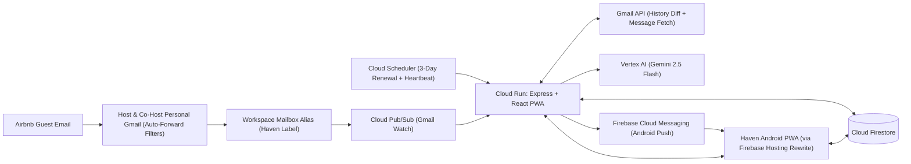

# Haven Co-Host: V1 Architecture & Implementation Plan

> Canonical engineering specification for `airbnb-agent`. Visual tokens and screen layouts are defined in `docs/DESIGN.md` and `docs/stitch_prototype_reference.html`.

## 1. Scope & Locked Product Decisions

Haven Co-Host is a mobile-first Android PWA for managing Airbnb guest messaging across multiple properties, grounded in verified per-property facts and tuned to your writing voice.

**Locked UX & Behavioral Decisions:**
* **Single-property active view** on Messages with a top-right property switcher and an unread count badge when another property has messages waiting.
* **Compact search bar + embedded Filter popover** (Status + Guest Stage) directly under the header, sorting Needs Reply and flagged threads to the top with Sent threads collapsed to two lines below.
* **Conditional unmatched fallback:** No permanent unassigned card in the default queue. If all property matchers fail on an incoming email, the backend routes it to an unmatched queue, refuses to auto-draft, sends an alert, and surfaces a dismissible banner only while unmatched items exist so you can assign the property in one tap.
* **Single primary responder:** No claim/release locks or backup escalation emails. Your husband can sign in with read/optional visibility via the Google Sign-In allowlist.
* **Direct-to-dialogue navigation:** Tapping a Needs Reply card opens Agent Dialogue directly. Tapping View thread (or any Sent card) opens the full-screen Guest Thread view with a manual reply logger at the bottom.
* **Quick dismiss & automatic co-host reply sync:** Needs Reply cards and Agent Dialogue include an "Already handled on Airbnb" dismiss action that clears the queue without logging an unused AI draft into tone-memory diffs. When an Airbnb message digest ends with a Host or Co-host message (for example, a co-host replying inside Airbnb, or your own native Airbnb reply forwarded via your husband's co-host inbox), ingestion logs all messages in order into Guest Thread and automatically marks the thread as answered without firing a push notification.
* **Per-property host context:** Properties support an optional primary-host/co-host sign-off override so co-hosted listings keep sign-offs consistent when guests address the primary host by name.
* **On-demand Turn 1 drafting:** Background email ingestion parses, matches, checks for discount triggers, saves to Firestore, and fires the Android push immediately. Turn 1 drafts generate lazily when you open Agent Dialogue so drafts always use the latest house rules, group rapid-fire guest bursts cleanly, and avoid wasted calls on threads answered natively in Airbnb.
* **Draft card behavior:** Every AI draft starting from Turn 1 supports inline Edit, Copy & Open Airbnb (using the thread or pending reservation deep link), and always-visible Mark as Sent (logs the final text, captures meaningful edits for tone memory, archives coaching notes, resets the active coaching session, and updates unread counts).
* **Net payout guardrail (15.5% host-only fee):** Calculates estimated net payout applying Airbnb's 15.5% host-only fee to accommodation plus listed cleaning fee (excluding occupancy taxes collected and remitted by Airbnb; verified to the penny against live Airbnb receipts). Displays the math breakdown with a one-tap toggle between "guest quote is all-in (incl. tax & cleaning)" and "room rate before fees/tax".
* **Hard prompt privacy guardrails:**
  * Server-side prompt assembly strips all `Access & Arrival` rules (door codes, Wi-Fi passwords, exact street address) whenever a thread is in `inquiry` stage (including inquiries, pre-approvals, and pending reservation requests).
  * Nightly price floor is passed strictly as a private constraint so the model never quotes your minimum floor to a guest.
  * Untrusted guest email content is strictly delimited from system instructions and house rules.
* **Reliable knowledge import (V1):** Paste Listing Text / Notes, PDF Upload (native Gemini multimodal), and Quick One-Liner Note, flagging conflicts (`Updates existing rule`) before merging. DOCX upload is excluded from V1.
* **Rule lifecycle:** Rule Details bottom sheet supports an optional Temporary / Seasonal Note expiration date so expired fixes are excluded automatically from AI prompts.
* **Curated tone memory:** Cap learned diffs at 15 rolling entries with delete controls in Account so prompt context stays sharp and low-cost.
* **Offline read resilience:** Enable Firestore local persistence so house rules, door codes, vendor contacts, and synced threads stay readable on weak cell signal.

---

## 2. System Architecture (Single Cloud Run Service + 100% Google Stack)

Follows the single-package React 19 + Vite + Tailwind v4 + modular Express + multi-stage Alpine Dockerfile architecture established in `TGIF-Project-Planner`, fronted by Firebase Hosting rewrite rules on a clean HTTPS origin.



### Key Architectural Choices

1. **Unified Cloud Run Container (React PWA + Modular Express API):**
   * Single `package.json`, single `npm run dev` (Express mounts Vite middleware locally), and single `Dockerfile` build (`vite build` + `esbuild server.ts` into `dist/server.cjs`) running on Cloud Run behind a Firebase Hosting rewrite.
   * One warm container serves the PWA and all `/api/*` routes on the same origin (zero CORS config, fewer cold starts across a session, native HTTP streaming for Turn 1 drafts, and direct PDF upload handling).
   * Service worker (`firebase-messaging-sw.js`) and `manifest.json` are served with `Cache-Control: no-cache` so Android Chrome always receives PWA updates reliably.
2. **Email Ingestion (Google Workspace Gmail API + Cloud Pub/Sub):**
   * Both your personal Gmail and your husband's Gmail (for listings he co-hosts) run a filter forwarding Airbnb emails (`from:@airbnb.com`, keeping a copy in each inbox) to a free alias on your existing Google Workspace mailbox (no extra seat needed).
   * A Workspace Gmail filter applies a dedicated `Haven` label and skips the Workspace inbox so business email stays clean.
   * The Firebase/GCP project lives inside your Google Workspace organization so OAuth uses an **Internal** consent screen (no public app verification, no 7-day refresh token expiration) with read-only Gmail access scoped strictly to that one mailbox.
   * Cloud Pub/Sub pushes Gmail watch notifications to `POST /api/internal/gmail-push`, and Cloud Scheduler hits `POST /api/internal/renew-watch` every 3 days to renew the 7-day watch and check ingestion health (sending an FCM alert on failure).
   * Both internal routes verify Google-signed OIDC tokens from the Pub/Sub and Scheduler service accounts.
   * Sync uses Gmail's history cursor (monotonic updates + `404` fallback), deduplicates at two layers (first by `gmailMessageId`, then per-message inside each thread by a deterministic content fingerprint of `(role, senderName, normalizedBody)` so duplicate copies forwarded from both personal inboxes never create duplicate bubbles or double push alerts), filters non-guest Airbnb noise (payouts, review reminders, inquiry reminders, arrival reminders, promos), and triggers FCM push immediately without waiting on Vertex AI.
3. **AI Access (Vertex AI):**
   * Uses `@google/genai` configured with `vertexai: true` in a US region inside the same GCP project.
   * Authenticates automatically via the Cloud Run service account (`roles/aiplatform.user`), with zero static API keys and paid privacy terms by default.
   * Model ID (`gemini-2.5-flash`) is read from configuration (`VERTEX_MODEL_ID`) so upgrades take one env change.
4. **Authentication & Security:**
   * Firebase Auth with Google Sign-In only.
   * Express auth middleware verifies Firebase Auth ID tokens (`firebase-admin`) plus `email_verified === true` against the explicit allowlist on every user-facing `/api/*` route.
   * Firestore Security Rules enforce the same verified-email allowlist on client reads/writes and restrict server-only ingestion collections to Admin SDK writes.
   * In local development (`NODE_ENV !== 'production'` when Firebase env vars are absent), provide a clean local in-memory/seed data adapter so the entire app is navigable and testable locally without live GCP credentials.
5. **Handling Rapid-Fire Guest Messages:**
   * Before you open a thread, incoming messages append to the open unanswered burst with no wasted draft calls.
   * If a guest sends another message while an active coaching session is already open, ingestion appends it to the pinned burst and sets `hasNewGuestMessageSinceEdit: true`, showing a `"New guest message arrived · Refresh draft"` banner without overwriting your edits.

---

## 3. Firestore Data Model (Multi-Property From Day 1)

* `config/access`: `allowedEmails: string[]`
* `config/voiceProfile`:
  * `styleRules: string[]` (concise, direct, no em-dashes, no sycophantic openers)
  * `signOffMode: "collective" | "individual" | "none"`
  * `signOffText: string`
  * `learnedDiffs: Array<{ id, originalDraft, finalSent, summary, createdAt }>` (capped rolling window of 15 entries, deletable in Account)
* `config/ingestionState` (server-only): `lastHistoryId`, `watchExpiresAt`, `watchedLabelId`, `watchedEmail`
* `config/ingestionHealth`: `status`, `lastPushAt`, `lastEmailReceivedAt`, `watchExpiresAt`, `lastError`
* `processedEmails/{gmailMessageId}` (server-only dedupe log): `receivedAt`, `classification` (`guest_message` | `host_reply_sync` | `ignored_noise` | `unmatched`), `propertyId | null`, `threadId | null`
* `unmatchedEmails/{emailId}`: `gmailMessageId`, `guestName`, `subject`, `bodyPreview`, `rawParsed`, `receivedAt`, `resolved: boolean`
* `users/{uid}`: `email`, `displayName`, `fcmTokens: string[]`, `pushEnabled: boolean`
* `properties/{propertyId}`:
  * `name`, `code` (`A`, `B`, `C`), `accentColor` (`#095C57`, `#8C4A00`, `#7F2A44`)
  * `airbnbListingIds: string[]`, `titleAliases: string[]`
  * `signOffOverride: string | null` (optional per-property host/co-host sign-off)
  * `needsReplyCount: number`, `flaggedCount: number` (maintained transactionally by backend)
  * `pricing`: `{ nightlyFloor, cleaningFee, localTaxPct, hostServiceFeePct }` (default `hostServiceFeePct: 15.5`)
  * `vendors: Array<{ id, name, role, phone, notes }>`
  * `knowledgeSources: Array<{ id, title, type, uploadedAt, ruleCount }>`
* `properties/{propertyId}/rules/{ruleId}`:
  * `topic`, `value`, `category` (`Access & Arrival` | `Timings & Rates` | `Amenities & Rules`), `origin`, `isTemporary`, `expiresAt | null`, `updatedAt`
* `properties/{propertyId}/threads/{threadId}`:
  * `guestName`, `guestCount`, `stayDates`, `airbnbThreadId`, `reservationCode`, `airbnbThreadUrl`, `stage` (`inquiry` | `confirmed` | `current`)
  * Thread merging matches by `airbnbThreadId` first, then `reservationCode`, then `(propertyId, guestName, stayDates)` within 14 days so follow-up digests merge cleanly and backfill `airbnbThreadId`.
  * `status` (`needs_reply` | `flagged` | `sent` | `dismissed`), `unansweredCount`, `lastMessageAt`, `lastPreview`, `lastSentPreview`
  * `discountAlert: { offeredAmount, nights, defaultAssumption, allIn, roomOnly, triggersWarning, matchedSnippet } | null`
  * `activeCoachSession: { turns: Array<{ id, sender, text, note, draft, editedByUser, createdAt }>, hasNewGuestMessageSinceEdit: boolean } | null` (cleared and archived on send or dismiss)
* `properties/{propertyId}/threads/{threadId}/messages/{messageId}`:
  * `gmailMessageId`, `contentFingerprint` (deterministic hash for dual-inbox dedupe), `sender` (`guest` | `host`), `senderName`, `body`, `sentAt`, `unanswered: boolean`, `loggedManually: boolean`, `archivedCoachNotes: string[]`

---

## 4. Repository Layout (Repo Root: `airbnb-agent/`)

```text
airbnb-agent/
├── .gitignore                              # Ignores local-samples/, raw *.eml, .env
├── .dockerignore
├── .env.example
├── Dockerfile                              # Multi-stage Node 22 Alpine build for Cloud Run
├── firebase.json                           # Hosting rewrite -> Cloud Run + firestore.rules
├── firestore.rules
├── firestore.indexes.json
├── package.json                            # Single unified package (React/Vite + Express + Vitest)
├── tsconfig.json
├── vite.config.ts
├── vitest.config.ts
├── index.html
├── server.ts                               # Thin Express entry point (/api + Vite dev / dist prod)
├── docs/
│   ├── DESIGN.md                           # Haven visual tokens & V1 UI reconciliation rules
│   ├── IMPLEMENTATION_PLAN.md              # This canonical plan
│   ├── OVERNIGHT_OWL_PROMPT.md             # Handoff brief for autonomous Stages 1-4 execution
│   └── stitch_prototype_reference.html     # Extracted Stitch Interactive Workflow Prototype HTML
├── public/
│   ├── manifest.json                       # Android PWA install metadata
│   └── firebase-messaging-sw.js            # Background push handler + cold/warm deep-linking
├── scripts/
│   ├── inspect-samples.ts                  # Stage 0 local .eml diagnostic runner
│   └── setup-gcp-triggers.sh               # One-time Pub/Sub push & 3-day Cloud Scheduler setup
└── src/
    ├── main.tsx
    ├── App.tsx                             # Auth gate + view router + active property context
    ├── index.css                           # Haven design tokens (colors, fonts, spacing)
    ├── types/
    │   └── haven.ts                        # Shared frontend/backend TypeScript domain interfaces
    ├── data/
    │   └── seedData.ts                     # Anonymized local dev & test fixtures
    ├── services/
    │   ├── firebase.ts                     # Auth, Firestore (offline persistence), Messaging init
    │   ├── havenStore.ts                   # Repository abstraction (Firestore live + local dev adapter)
    │   └── apiClient.ts                    # Typed fetch wrapper attaching Firebase Auth Bearer token
    ├── hooks/
    │   ├── useProperties.ts                # Live properties + unread counts + unmatched count
    │   ├── useThreads.ts                   # Live threads + messages + on-demand draft / dismiss actions
    │   ├── usePropertyRules.ts             # Live rules + vendor CRUD + expiry filtering
    │   └── usePushNotifications.ts         # Android FCM permission + token registration
    ├── components/ui/
    │   ├── SearchInput.tsx                 # Flex search input with embedded Filter slot
    │   ├── SelectPopover.tsx               # Custom accessible dropdown (zero native <select>)
    │   ├── DatePickerPopover.tsx           # Custom calendar popover for temporary rule expiry
    │   └── BottomSheet.tsx                 # Reusable sheet for Rule Details & Vendor forms
    ├── views/
    │   ├── MessagesView.tsx                # Single-property queue + conditional unmatched banner
    │   ├── AgentDialogueView.tsx           # Pinned burst + lazy Turn 1 + payout breakdown + Dismiss
    │   ├── GuestThreadView.tsx             # Full-screen chronological history + Log manual reply
    │   ├── HouseDetailsView.tsx            # Spec sheet + Floor/Cleaning/Tax + Vendor contacts
    │   ├── RuleDetailsSheet.tsx            # Structured rule editor + Temporary/Seasonal expiry toggle
    │   ├── ImportKnowledgeView.tsx         # Paste text / PDF upload / One-liner + conflict checklist
    │   └── AccountView.tsx                 # Profile + Push Alerts + Gmail Watch Health + Editable Diffs
    └── server/
        ├── routes/
        │   ├── index.ts                    # Central /api router
        │   ├── coachRoutes.ts              # POST /api/coach/turn, /api/threads/:id/sent, /dismiss
        │   ├── knowledgeRoutes.ts          # POST /api/knowledge/extract (paste + PDF + one-liner)
        │   ├── unmatchedRoutes.ts          # POST /api/unmatched/:id/assign
        │   └── internalRoutes.ts           # POST /api/internal/gmail-push, /renew-watch (OIDC)
        ├── middleware/
        │   ├── requireHostAuth.ts          # Firebase ID token + email_verified + allowlist check
        │   └── requireGoogleOidc.ts        # Pub/Sub & Cloud Scheduler OIDC token verification
        ├── config/
        │   ├── firebaseAdmin.ts            # Firestore + Auth + Messaging Admin SDK init
        │   └── vertex.ts                   # Vertex AI (@google/genai) client + structured schemas
        ├── services/
        │   ├── emailParser.ts              # [Stage 0 DONE] RFC 822 MIME + 4 Airbnb templates + noise filter
        │   ├── propertyMatcher.ts          # [Stage 0 DONE] Thread ID -> Listing ID -> Title alias matching
        │   ├── payoutMath.ts               # [Stage 0 DONE] 15.5% host-only fee (all-in & room-only modes)
        │   ├── discountDetector.ts         # [Stage 0 DONE] Deterministic price/offer & intent extraction
        │   ├── messageFingerprint.ts       # Dual-inbox message content fingerprinting for dedupe
        │   ├── promptBuilder.ts            # Inquiry Access-rule redaction + active rules + voice diffs
        │   ├── gmailClient.ts              # Workspace Internal OAuth + history diff + watch renewal
        │   ├── ingestionService.ts         # Two-layer dedupe, thread merge, co-host sync, FCM trigger
        │   └── pushNotifier.ts             # FCM Android Web Push + stale token cleanup
        └── __tests__/
            ├── fixtures/                   # [Stage 0 DONE] Anonymized .eml fixtures (zero real guest PII)
            ├── emailParser.test.ts         # [Stage 0 DONE]
            ├── propertyMatcher.test.ts     # [Stage 0 DONE]
            ├── payoutMath.test.ts          # [Stage 0 DONE]
            ├── discountDetector.test.ts    # [Stage 0 DONE]
            ├── promptBuilder.test.ts
            └── ingestionService.test.ts
```

---

## 5. Phased Implementation Plan

### Stage 0: Real-Email Parsing Spike — COMPLETE
* Verified against 11 real Airbnb email exports covering confirmed digests, multi-message guest bursts, co-host reply digests, initial inquiries, pre-approvals, pending reservation requests, inquiry reminders, and arrival reminders.
* Confirmed 15.5% host-only fee + 14% Richmond occupancy tax math to the exact cent against a live Airbnb receipt.
* 30 unit tests and strict `tsc --noEmit` passing with anonymized `.eml` fixtures.

### Stage 1: Project Scaffold, Express Entry Point, Theme Tokens & Core UI Primitives
* Add React 19, Vite, Tailwind v4, Express, `lucide-react`, `@google/genai`, `firebase`, `firebase-admin`, `@testing-library/react`, and `jsdom`.
* Add `server.ts`, `vite.config.ts`, `index.html`, `Dockerfile`, `.dockerignore`, `.env.example`, `firebase.json`, `firestore.rules` (verified-email allowlist), and `firestore.indexes.json` matching the `TGIF-Project-Planner` Cloud Run pattern.
* Implement Haven design tokens (`src/index.css`), Firestore offline persistence + local dev seed adapter (`src/services/havenStore.ts`, `src/data/seedData.ts`), `apiClient.ts`, and custom accessible UI primitives (`SearchInput`, `SelectPopover`, `DatePickerPopover`, `BottomSheet`) with strict light-mode input styling.
* Verify clean `npm run lint`, `npm test`, and `npm run build`.

### Stage 2: Core Messaging Views (Messages, Agent Dialogue, Guest Thread)
* Implement `MessagesView` with single-property switcher, cross-property unread badge, conditional unmatched alert banner, search + embedded Filter popover, stacked multi-message cards, compact handled cards, and quick dismiss trigger.
* Implement `AgentDialogueView` with collapsible pinned burst, on-demand Turn 1 drafting + multi-turn coaching, inline editing, `Copy & Open Airbnb`, `Mark as Sent`, `Already handled on Airbnb` dismiss action, new-message refresh banner, and interactive net payout breakdown toggle (`All-in` vs `Room rate only`).
* Implement full-screen `GuestThreadView` with chronological bubbles, collapsed coaching notes disclosure, `+ Log manual reply`, and stateful back navigation preserving draft edits.

### Stage 3: Property Knowledge & Account
* Implement `HouseDetailsView` (Nightly Price Floor, Listed Cleaning Fee, Local Tax %, Host Fee %, optional per-property sign-off override, categorized rules inside bounded scroll containers, vendor contacts with call/edit) and `RuleDetailsSheet` with optional Temporary / Seasonal Note expiration date (`DatePickerPopover`).
* Implement `ImportKnowledgeView` for Paste Listing Text, PDF upload, and Quick One-Liner notes with `Updates existing rule` conflict review before merging.
* Implement `AccountView` with Google Sign-In allowlist check, Android Push Alerts toggle, Gmail Watch & Dual-Inbox Health card, Sign-Off & Style Guardrails, and editable/deletable tone-memory diffs (max 15).

### Stage 4: Express Backend Routes, Workspace Gmail + Pub/Sub, Vertex AI & FCM Push
* Implement `requireHostAuth.ts`, `requireGoogleOidc.ts`, `messageFingerprint.ts`, `promptBuilder.ts` (strict inquiry/pre-approval/pending `Access & Arrival` rule redaction, private floor constraint, no em-dashes, no sycophantic openers), `gmailClient.ts`, `ingestionService.ts` (two-layer dedupe, pending-request-to-thread merging, automatic co-host reply sync), `pushNotifier.ts`, and Express routes under `src/server/routes/`.
* Wire `coachRoutes.ts`, `knowledgeRoutes.ts`, and `unmatchedRoutes.ts` to Vertex AI (`gemini-2.5-flash`) with graceful structured responses and local dev fallback when GCP credentials are absent.
* Complete `public/manifest.json`, `public/firebase-messaging-sw.js` (cold/warm deep-linking + stale token cleanup), and `scripts/setup-gcp-triggers.sh`.
* Add comprehensive backend unit tests (`promptBuilder.test.ts`, `ingestionService.test.ts`) and React Testing Library end-to-end journey tests covering all views and authentic multi-step flows.

### Stage 5: Live GCP / Workspace Setup & Deployment (Interactive Human Checkpoint)
* Create the Firebase/GCP project under your Google Workspace organization, enable Vertex AI and Gmail API, configure the Internal OAuth consent screen, and set up personal + husband Gmail forwarding into the Workspace `Haven` label.
* Deploy the Cloud Run container, Firebase Hosting rewrite, Firestore rules, and Pub/Sub + 3-day Cloud Scheduler triggers via `scripts/setup-gcp-triggers.sh`.
* Install the PWA on Android Chrome and test end-to-end with a real forwarded Airbnb email and push notification tap.
